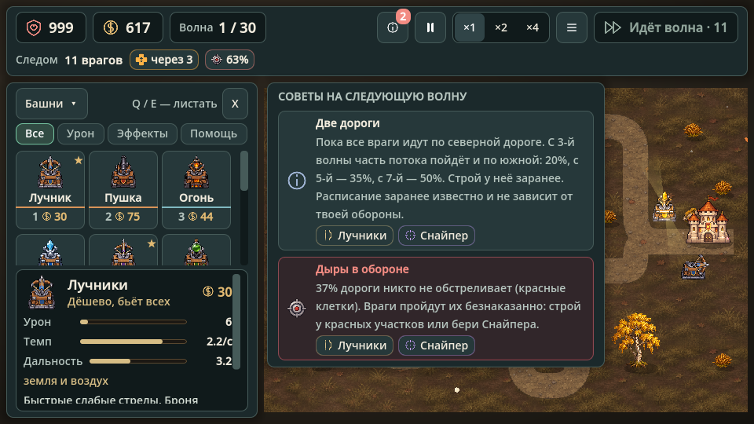
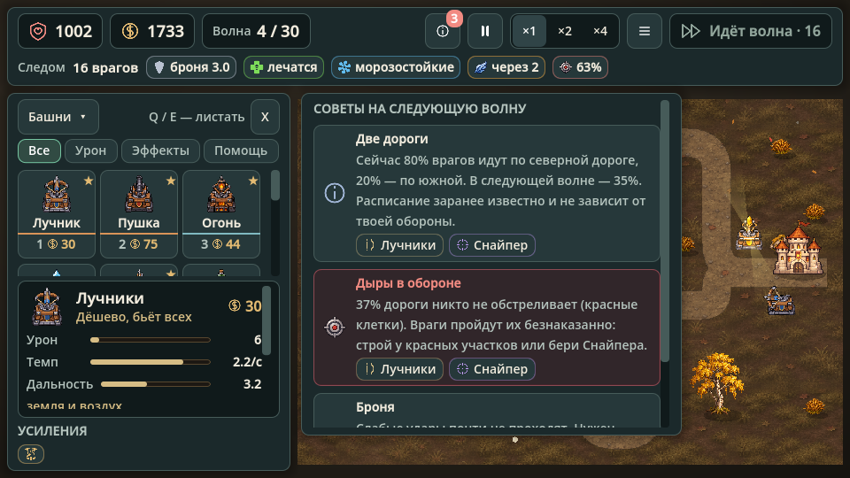

# PRO-214 · Баланс развилок 1–10: постепенный ввод второй дороги

**База:** ветка PRO-213 (PR #17, `ca1184e`) → PR #16 (PRO-147) → PR #15 (PRO-139) → #14 → #13 → #11. Ни один из них не слит. **Голова:** `timberwolfmax/pro-214-out-balans-razvilok-110-postepennii`.

**Статус: эксперимент отвергнут ботами, ничего не включено.** Расписание ввода второй дороги реализовано под dev-флагом, в обычную ротацию и в обычные забеги не попадает. Ручной A/B владельца (живой gate, §9) ещё не сделан: я не могу играть в окно игры. До него решение окончательным не считается, но по ботам оно однозначное.

## Короткий вывод

- **Постепенный ввод второй дороги не делает развилку проходимой.** На независимом холдауте (20 новых сидов, 4 стратегии, normal/hard, обе развилки) ни одно из 9 плеч (6 с расписанием, 2 с золотом, 1 их сочетание) не выполнило зарегистрированные пороги: normal win30 0,10–0,44 вместо ≥ 0,70 (у плеч с расписанием не выше 0,35), hard 0,00–0,06 вместо ≥ 0,20. Расписание **не лучше текущего 50/50** (парная разность win30 от −0,09 до +0,02 у плеч B).
- **Почему.** Ранняя фаза действительно становится легче только там, где первой идёт дорога, которую бот уже защитил. Но вторая дорога подключается с 3-й волны, и оборону для неё всё равно надо строить на те же деньги: её не обстреливают (cov20 0,25–0,55 к 5-й волне), и прорывы с 3-й волны переходят на вторую дорогу. **Расписание сдвигает боль, а не снимает её.** Требуемое удвоение покрытия остаётся.
- **Основные поражения на normal — не в волнах 1–10.** У A на normal 47–51% партий заканчиваются в волнах 11–20 (включая босса 20-й), в волнах 1–9 — 1–3%. Расписание, которое кончается к 7-й волне, на это не влияет. Только на Hard большинство партий (66–75%) гибнет до 10-й волны, и расписание это тоже не исправляет.
- **Единственное, что заметно двигает числа, — стартовое золото**: +50 даёт win30 normal 0,44 / 0,38 вместо 0,25 / 0,29, но это тоже далеко от порога 0,70, и это та экономика, которую задача велела не трогать по умолчанию.
- **Что это значит для владельца.** По ботам развилки с одним порталом остаются dev/challenge: честный баланс с расписанием не достигнут. Решение о дальнейшем — отдельное (§8). Не внедрялось: второй портал (PRO-141), адаптивная доля (PRO-140), золото по умолчанию, длина общего ствола. Не менялись боевой баланс обычных карт, HP, награды, число врагов, RNG.

## 1. Что реализовано

Флаг `--route-ramp=pilot|early|slow` и `--route-lead=short|long|0|1` (по умолчанию `short`) в `main.gd`, `godot\run_fork.bat even 1003 ramp` (`ramp-long` — первой идёт длинная). Без флага всё как в PRO-213.

**Правило.** У `TDMap` — `route_ramp` (ступени `[с_волны, % врагов на второй дороге]`) и `route_lead` (дорога, несущая поток, пока вторая не подключена). k-й враг волны идёт по второй дороге, если `(k+1)·p/100 > k·p/100` (целочисленно), иначе по первой. Без RNG, без реакции на оборону. Число врагов, их гены, HP и награды не меняются — только маршрут. На 50% правило даёт прежний порядок 0, 1, 0, 1 (при `route_lead = 0`).

| Расписание | Волны и доля второй дороги |
|---|---|
| `pilot` (гипотеза из задачи) | 1–2: 0% · 3–4: 20% · 5–6: 35% · с 7-й: 50% |
| `early` (ограниченный пилот 90/10) | 1: 0% · 2–3: 10% · 4–5: 30% · с 6-й: 50% |
| `slow` (добавлено после пилота, §2) | 1–3: 0% · 4–6: 20% · 7–9: 35% · с 10-й: 50% |

**Остальное.**
- *Объяснение игроку* (`TDAdvisor.ramp_text`): подсказка «Две дороги» называет первую дорогу, волну подключения второй и доли; затем — текущую долю и долю следующей волны. Говорит, что расписание заранее известно и не зависит от обороны. Рой, адаптация и эволюция не упоминаются. Тревога «Открыта … дорога» не показывается, пока второй дороге не предстоит поток в этой или следующей волне, и срабатывает за волну до подключения.
- *Сохранения*: `route_ramp` и `route_lead` пишутся только при заданном расписании, валидируются (волны с 1-й и по возрастанию, доли 0–50 не убывают, лидер — одна из двух дорог). Сохранения без расписания остаются прежними.
- *Рекорды (PRO-147)*: расписание — другое испытание, в каноническую запись геометрии добавляется строка `ramp:…`; без него ключ прежний.
- *Журнал плейтеста*: в заголовке `route_ramp`, `route_lead`; в конце волны `second_road_pct`.
- *Харнесс*: `--ramp=pilot[:short|long]`, `--start-gold=N` (диагностика, только на развилке), `--ramp-aware=1` (бот знает расписание и оценивает клетки по средней доле дороги за волны `w…w+2`).

## 2. План эксперимента и регистрация порогов

Плечи (`tests/fork_ramp_matrix.sh`):

| Плечо | Что |
|---|---|
| **A** (`a`) | как сейчас: 50/50 с первой волны (байт-в-байт равно матрице PRO-213) |
| **B** (`b_short`, `b_long`) | расписание `pilot`, первой идёт короткая / длинная дорога; бот строит под установившиеся 50/50, расписания не знает |
| **B, бот знает расписание** (`ba_short`, `ba_long`) | то же расписание; бот строит под ближайшие три волны |
| **B, ранний** (`e_short`, `ea_short`) | `early` (90/10) — ограниченный пилот |
| **C** (`c25`, `c50`) | диагностический контроль: +25 / +50 золота единожды на старте, поток 50/50, дальше экономика прежняя |
| **D** (`d_short`) | B + 25 золота; запущен одним плечом, потому что B в пилоте не дотянул до порогов |

Хронология (честно, в порядке событий):
1. **До пилота** зафиксирован `registration.json` v0 (коммит `d5185c8`): пороги ниже.
2. **Пилот** — сиды 0–9, плечи A, B (оба лидера), `early`, C, 4 стратегии × normal/hard × обе развилки. Расписание с неосведомлённым ботом не помогло. Я предположил, что причина в боте, который строит под 50/50, и **добавил** осведомлённого бота и расписание `slow` — после просмотра пилота, поэтому в итоговые выводы они вошли как дополнительные, а не как зарегистрированные заранее. В холдаут `slow` не включён: в пилоте он оказался хуже всех (win30 normal 0,03–0,25).
3. **Пороги v1** (`5cdb9d9`) — до холдаута: числа v0 не менялись (пилот показал, что эталоны из задачи не достигаются ни одним плечом, подгонять их незачем), добавлены два критерия механизма: утечки 1–10 ≤ 0,8 × A и жизней к 10-й не больше, чем в A.
4. **Холдаут** — сиды `(1000+i+1)·4243`, ранее не просматривались: 20 партий на ячейку (основная матрица), 10 — на чувствительности.

**Зарегистрированные пороги** (`data/pro214/registration.json`), каждый — отдельно для `fork_even` и `fork_skew`:

| Критерий | Порог |
|---|---|
| win30 normal, pooled | ≥ 0,70 и ≤ 0,95 (не легче одиночных карт: решения нужны) |
| win30 normal, **каждая** стратегия | ≥ 0,50 |
| win30 hard, pooled | ≥ 0,20 и ≤ 0,60 |
| win30 hard | ≥ 3 из 4 стратегий выигрывают ≥ 0,10 |
| win30 парно к A | Δ ≥ 0 |
| утечки 1–10 на волну | ≤ 0,80 × A (механизм: ранняя фаза легче) |
| жизни, потерянные к 10-й | не больше, чем в A |
| поздняя игра (волны 21–29) | \|Δgate20\| и \|Δcov20\| ≤ 0,05 |
| расстановки «как у человека» | «все башни у второй дороги» даёт ≥ 2× прорывов на первой, «все у первой» — ≥ 2× на второй против «поровну» |

**Правило приёмки:** расписание принимается для dev/challenge-ротации, только если хотя бы одно плечо B выполняет **все** пороги в обеих семьях на холдауте и не проваливает чувствительности ON/Мастерская. Иначе — отчёт без внедрения.

## 3. Пилот (сиды 0–9, по 80 партий в семье)

Полные таблицы: `data/pro214/pilot_summary.md`, `pilot_games.csv`. Кратко, win30 normal / hard:

| Плечо | fork_even | fork_skew |
|---|---|---|
| A | 0,30 / 0,03 | 0,42 / 0,08 |
| B `pilot`, первая короткая / длинная (бот не знает) | 0,33 / 0,03 · 0,38 / 0,03 | 0,35 / 0,05 · 0,45 / 0,07 |
| B, бот знает: короткая / длинная | 0,25 / 0,00 · 0,10 / 0,00 | 0,33 / 0,03 · 0,12 / 0,00 |
| `early` короткая / длинная (бот не знает) | 0,38 / 0,00 · 0,38 / 0,03 | 0,33 / 0,05 · 0,42 / 0,08 |
| `slow`, бот знает: короткая / длинная | 0,15 / 0,00 · 0,08 / 0,03 | 0,25 / 0,03 · 0,03 / 0,00 |
| C +25 / +50 | 0,40 / 0,05 · 0,42 / 0,05 | 0,47 / 0,12 · 0,42 / 0,12 |

Осведомлённый бот не помог, а ухудшил результат: первая дорога получала хорошую защиту (cov20 0,71–0,94), а вторая к её подключению — нет (cov20 0,21–0,53 к 5-й волне).

## 4. Холдаут: основная матрица

Сиды 1000–1019, модель роя `off`, без Мастерской, по 160 партий на плечо в семье (4 стратегии × normal/hard × 20 сидов). Полные таблицы, CSV и вердикт: `data/pro214/holdout_summary.md`, `holdout_games.csv`.

| Плечо | fork_even normal / hard | fork_skew normal / hard | утечки/волну 1–10 (even / skew) | жизней потеряно к 10-й (even / skew) |
|---|---|---|---|---|
| **A** (50/50) | 0,25 / 0,01 | 0,29 / 0,00 | 1,30 / 1,22 | 10,9 / 10,0 |
| B, первая короткая | 0,28 / 0,03 | 0,20 / 0,00 | 1,34 / 2,40 | 10,1 / 10,5 |
| B, первая длинная | 0,23 / 0,01 | 0,20 / 0,01 | 1,25 / 0,83 | 10,6 / 10,4 |
| B, бот знает: короткая | 0,18 / 0,00 | 0,21 / 0,06 | 0,97 / 0,82 | 12,2 / 10,0 |
| B, бот знает: длинная | 0,12 / 0,01 | 0,10 / 0,00 | 0,95 / 1,04 | 12,6 / 13,5 |
| ранний (90/10), короткая | 0,28 / 0,00 | 0,14 / 0,00 | 1,37 / 2,48 | 10,7 / 10,7 |
| ранний, бот знает | 0,15 / 0,01 | 0,25 / 0,01 | 1,17 / 0,87 | 12,4 / 10,3 |
| C +25 | 0,29 / 0,03 | 0,38 / 0,03 | 0,64 / 0,61 | 9,6 / 9,1 |
| C +50 | 0,44 / 0,05 | 0,38 / 0,04 | 0,32 / 0,36 | 8,7 / 8,1 |
| D (B + 25) | 0,26 / 0,05 | 0,35 / 0,03 | 0,65 / 0,99 | 9,3 / 8,9 |

Парная разность win30 (B − A, по сидам и стратегиям; пар лучше / хуже), fork_even → fork_skew:
- B короткая: +0,02 (11 / 8) → −0,04 (6 / 13);
- B длинная: −0,01 (8 / 10) → −0,04 (7 / 13);
- B, бот знает: −0,04 и −0,09 → −0,01 и −0,09;
- C +50: **+0,11 (25 / 7)** → +0,06 (19 / 9);
- D: +0,03 → +0,04.

**Вердикт по порогам: ни одно из 9 плеч не выполнило их все** (у плеч B провалены 12–15 из 20 критериев; у C +50 — 8). Список по плечам — в конце `holdout_summary.md`. Лучшая отдельная стратегия на normal ни в A, ни в одном плече B не дотягивает до 0,50 (A: 0,35 / 0,45; B — не выше 0,40; `fork_even` / `fork_skew`), так что средним провал не прикрыт.

## 5. Где и почему проигрывают

**Где заканчиваются партии** (холдаут, доля партий, normal / hard; `fork_even`):

| Плечо | победа | 1–9 | 10 (босс) | 11–19 | 20 (босс) |
|---|---|---|---|---|---|
| A | 0,25 / 0,01 | 0,03 / 0,66 | 0,16 / 0,25 | 0,30 / 0,01 | 0,17 / 0,05 |
| B, первая короткая | 0,28 / 0,03 | 0,04 / 0,66 | 0,14 / 0,19 | 0,17 / 0,06 | 0,24 / 0,05 |
| C +50 | 0,44 / 0,05 | 0,00 / 0,25 | 0,09 / 0,36 | 0,19 / 0,10 | 0,24 / 0,21 |

Для сравнения, одиночные карты (база PRO-212, 160 партий): normal — победа 0,89, 11–19-я 0,02, босс 20-й 0,04; hard — победа 0,43, 1–9-я 0,03, босс 10-й 0,26.

- На **normal** развилка проигрывается в **середине игры** (волны 11–20 и босс 20-й), а не в первые 10 волн. Постепенный ввод, закончившийся к 7-й волне, к этому не относится.
- На **hard** 66–75% партий (A) погибает до 10-й волны, на одиночных картах — 3%. Расписание бьёт именно сюда, но результат тот же (0,66–0,80 у B): гибель переезжает на вторую дорогу после её подключения.

**По дорогам** (волны 1–10, утечки на волну, холдаут `fork_even`, короткая / длинная): A — 0,50 / 0,81; B-короткая — 1,09 / 0,25; B-длинная — 0,09 / 1,16; B, бот знает, короткая — 0,17 / 0,80. На `fork_skew` с короткой первой дорогой (B) утечки на ней 2,27 на волну: 100% потока по короткой дороге бот не держит. Лидер получает почти весь поток первые две волны, но поток второй с 3-й волны всё равно по необстреливаемой дороге.

**Ранняя экономика** (волны 1–10): золото перед строительством, вложенное к 5-й / 10-й волне и число башен в плечах A и B практически совпадают (вложено 303 / 815 против 305 / 822 у B-короткая; башен 4,6 / 9,3 против 4,6 / 8,8). Расписание **экономику не меняет**: доход волн 1–10 (убийства + бонус + проценты) 467 против 459. Больше денег у А/B нет, и башен на вторую дорогу нужно столько же. Золото в плече C даёт +28…+55 вложенного к 10-й, и именно оно уменьшает утечки (0,32 на волну против 1,30 у A).

**Поздняя игра** расписанием не затронута: gate20 и cov20 в волнах 21–29 у плеч B отличаются от A в пределах шума (cov20 1,00). Это выбор партий, доживших до 21-й, их мало (9–31%).

## 6. Чувствительности

**Адаптация роя ВКЛ** (`--model=signature`, сиды 1000–1009, по 80 партий в семье). win30 normal, fork_even / fork_skew: A 0,15 / 0,20; B-короткая 0,23 / 0,23; B, бот знает 0,23 / 0,12; C +50 0,50 / 0,25. Картина та же: B ≈ A, C +50 лучше, пороги не выполнены. `data/pro214/holdout_on_summary.md`.

**Мастерская на максимуме** (`owner2`, `mixed`, сиды 1000–1009, по 40 партий): normal win30 fork_even / fork_skew — A 0,80 / 0,50; B-короткая 0,70 / 0,55; B, бот знает 0,45 / 0,60; C +50 0,80 / 0,45. С Мастерской развилка проходима и без расписания; расписание ничего не улучшает. `data/pro214/holdout_ws_summary.md`.

**Замороженный повтор покупок** (`tests/fork_ramp_replay.sh`, 10 сидов, до 12-й волны; одни и те же покупки, перки и улучшения из партий A повторяются при расписании): жизней к 10-й на normal fork_even −0,5 (`pilot`, первая короткая; пар лучше / хуже 14 / 16) и −0,9 (первая длинная; 13 / 17), на fork_skew +1,1 (первая короткая; 20 / 13) и −0,1 (длинная). То есть на той же обороне расписание снимает ≈ 0,5–1 жизнь из ~10 на равных дорогах и ухудшает результат, когда первой идёт короткая дорога у `fork_skew`. Эффект маленький и разнонаправленный. `data/pro214/replay_summary.md`.

**Расстановки «как у человека»** (`tests/fork_ramp_layouts.gd`, одинаковый набор башен: 3 в 1-й волне, +1 за волну до 10; золото не ограничивает; 20 сидов): прорывов на волну в волнах 3–9, `fork_even`, короткая / длинная дорога:

| Расстановка | A (50/50) | B, первая короткая | B, первая длинная |
|---|---|---|---|
| лагерь у входа | 0,93 / 2,39 | 1,10 / 2,42 | 0,98 / 2,80 |
| поровну | 1,27 / 0,59 | 1,67 / 0,46 | 1,33 / 0,72 |
| все у короткой | 0,08 / 6,03 | 0,05 / 4,95 | 0,05 / 8,18 |
| все у длинной | 6,97 / 0,15 | 9,03 / 0,13 | 5,19 / 0,08 |

Критерий «развилка требует решений» выполнен: оборона только одной дороги пропускает ≥ 2× прорывов на другой, и у B, и у A (например B-короткая: «все у короткой» → 4,95 на длинной против 0,46 при «поровну»). Лагерь у входа всё ещё накрывает обе дороги (в расписании это его не отменяет). Таблицы всех семей и плеч: `data/pro214/layouts/*.json`.

## 7. Технические проверки

`tests/fork_ramp_check.gd` (в CI, 34 проверки):
- правило и расписания (`pilot`, `early`, `slow`), `⌊n·p/100⌋` врагов на второй дороге при любой первой дороге, с 7-й волны — прежний порядок;
- ключ геометрии с расписанием другой, без него прежний; рекорды отдельные;
- на симметричной карте `fork` расписание не меняет гены волн, RNG, золото, жизни, число и HP врагов (10 волн); на сгенерированных развилках маршруты выпущенных врагов (включая босса 10-й волны) идут точно по расписанию;
- малыши и прислужники остаются на дороге родителя;
- сохранение перед 3-й волной (переход) и посреди 3-й волны (`route_k > 0`) даёт то же состояние боя; битые расписания в сохранении отвергаются; в сохранениях без расписания полей нет;
- подсказки: названы первая дорога, волна и доли, слов про адаптацию и рой нет; «Открыта … дорога» не срабатывает до подключения и срабатывает за волну до него.

**Расхождение, которое важно знать.** На развилках с дорогами разной длины гены волн после 1-й **расходятся** между A и B: отбор роя зависит от порядка прорыва, а он зависит от длины дороги. Это не сдвиг RNG расписанием (проверено на симметричной карте), но значит, что A и B играют разные последовательности волн после первой — парные сравнения по сидам этим ограничены.

**Паритет обычных карт** (до / после на `ca1184e` и этой голове): `balance_audit --late=1` на 14 ячейках (3 стратегии × 4 семейства на Hard + `signature` на двух семействах, по 3 сида, до 30-й волны) — **14 из 14 файлов байт-в-байт**; `tests/legacy_parity.gd` — **снимки 6 из 6**; плечо A байт-в-байт равно матрице PRO-213 (проверено на ячейке `owner2 normal fork_even`, 10 сидов); `fork_gen_check`, `fork_check`, `records_check` не менялись и проходят.

## 8. Что дальше (решение владельца)

По ботам постепенный ввод **не нужен и не помогает**; идти по нему дальше не рекомендую. Варианты, ничего из них не сделано:
- **Оставить развилки dev/challenge** (по умолчанию, ротацию не менять).
- Если развилки всё же нужны в ротации, рычаг — не порядок врагов, а то, что стоит за второй дорогой: второй портал и физическое разделение (PRO-141), либо экономика развилочных карт (не проверялась всерьёз: +50 золота даёт +0,06…+0,11 win30, до порога далеко, и это именно «добавление золота», от которого задача по умолчанию отказалась).
- Проверка живым игроком (§9) нужна, если владелец хочет проверить, не врут ли боты: у человека расстановка у развилки может иначе уравновесить дороги.

## 9. Обязательный живой gate (за владельцем)

Бот-статистика честность для человека не доказывает. Ручной A/B на одном seed, сначала Normal, затем Hard:

```bash
godot\run_fork.bat even 1003
```

```bash
godot\run_fork.bat even 1003 ramp
```

```bash
godot\run_fork.bat skew 1003
```

```bash
godot\run_fork.bat skew 1003 ramp
```

```bash
godot\run_fork.bat skew 1003 ramp-long
```

Первая и третья — контроль (50/50 с первой волны), остальные — вариант B (`ramp`: первой идёт короткая дорога; `ramp-long`: длинная). Сид фиксирует карту, волны и гены, поэтому варианты сравнимы. Журналы — `%APPDATA%\Godot\app_userdata\Outadapt\playtest\`; в заголовке расписание (`route_ramp`, `route_lead`), в конце волны — `second_road_pct`, по каждой дороге убито / прорвалось / доля обстрела.

Что записать в журнал (на каждый забег): где поставлены первые башни; на какой волне и на какой дороге была первая потеря жизни; когда стало ясно, что вторая дорога открывается (по подсказке, по шевронам, по врагам); успевал ли ответить (хватало золота / клеток); пришлось ли «чинить» оборону второй дороги в панике; в какой волне забег закончился.

Вопросы: 1) честно ли выглядит начало на ramp по сравнению с контролем; 2) объясняет ли подсказка «Две дороги» план, без намёка на адаптацию; 3) есть ли выбор или единственная правильная расстановка; 4) не нужна ли другая доля / момент подключения.

## 10. Интерфейс и скриншоты

Подсказка «Две дороги» на 1-й волне и на 4-й (сейчас 80/20, в следующей волне 35%). Кадры демо-режима (`--shot … --map=fork_even --route-ramp=pilot --ui=advice`; башни в кадре — демо-расстановка, золото и жизни демо):

| 960×540, 1-я волна | 960×540, 4-я волна |
|---|---|
|  |  |

`fork_skew`, 960×540: `img/pro214-fork_skew-1003-ramp-w1-960x540.png`. 1920×1080: `img/pro214-fork_even-1003-ramp-w1-1920x1080.png`, `img/pro214-fork_skew-1003-ramp-w1-1920x1080.png`.

## 11. Данные и команды

Из папки `godot`, `GODOT` — консольный Godot 4.7.2.

```bash
ARMS="a b_short b_long ba_short ba_long e_short ea_short c25 c50 d_short" GODOT=godot bash tests/fork_ramp_matrix.sh holdout 11 20 1000
```

```bash
ARMS="a b_short ba_short c50" MODELS="signature" GODOT=godot bash tests/fork_ramp_matrix.sh holdout_on 11 10 1000
```

```bash
ARMS="a b_short ba_short c50" WS="1" STRATS="owner2 mixed" GODOT=godot bash tests/fork_ramp_matrix.sh holdout_ws 11 10 1000
```

```bash
GODOT=godot bash tests/fork_ramp_replay.sh 11 10 1000
```

```bash
python tests/fork_ramp_report.py holdout --thresholds=../docs/architecture/data/pro214/registration.json --md=../docs/architecture/data/pro214/holdout_summary.md
```

| Файл (`data/pro214/`) | Что |
|---|---|
| `registration.json` | пороги: v0 до пилота (коммит `d5185c8`), v1 до холдаута (`5cdb9d9`) |
| `pilot_summary.md`, `pilot_games.csv` | пилот, сиды 0–9, 13 плеч |
| `holdout_summary.md`, `holdout_games.csv` | холдаут 1000–1019, вердикт по порогам |
| `holdout_on_summary.md`, `holdout_ws_summary.md` | чувствительности |
| `replay_summary.md` | замороженный повтор |
| `layouts/*.json` | расстановки |
| `commands_*.txt` | все команды прогонов |

**Ограничения.** Боты — не человек (§9). Осведомлённый бот — моя эвристика (вес дорог за три волны), другой человеческий приём она не покрывает. Чувствительности — по 10 сидов. Парные сравнения A и B ограничены тем, что последовательности волн после 1-й различаются (§7). Расписание `slow` и осведомлённый бот добавлены после пилота (§2).
