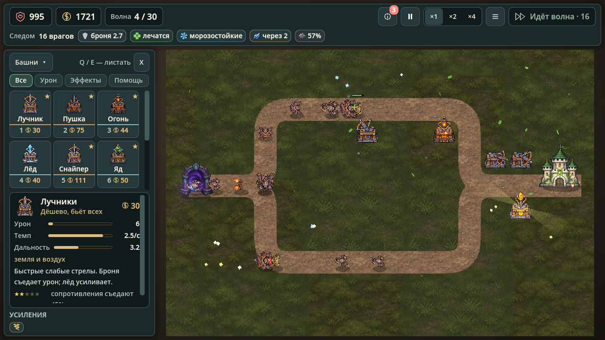
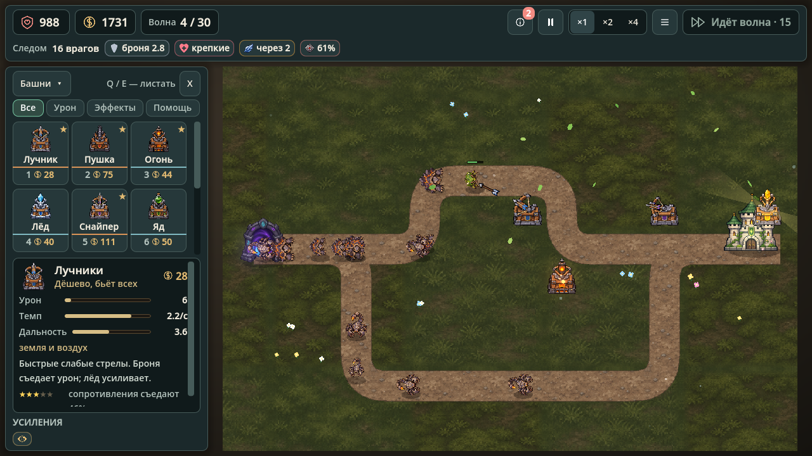

# PRO-139 · RFC: несколько маршрутов вместо одной полилинии

**База:** ветка PRO-212 (PR #14, `2875dc3`), под ней PR #13 и PR #11. Баланс в этих PR не менялся, их хуки только для тестов и по умолчанию выключены. **Голова:** `timberwolfmax/pro-139-out-issledovat-arkhitekturu-neskolkikh`.

**Статус:** RFC и изолированный прототип развилки. В обычные забеги ничего не внедрено: на картах с одним путём поведение байт-в-байт прежнее (§6). Адаптивный выбор ветки (PRO-140), второй портал (PRO-141) и мосты (PRO-142) здесь не делаются.

## 1. Решение коротко

- **Маршрут = готовая полилиния от портала до замка** (`TDPath`). Карта хранит список маршрутов `TDMap.routes`; на общих участках их точки совпадают.
- **У врага номер маршрута** `Enemy.route` и прежняя `dist` вдоль него. Маршрут назначается один раз при выходе из портала, по фиксированному шаблону карты `route_plan` (по умолчанию 0, 1, 0, 1, …). Идущий враг маршрут не меняет.
- **Обычная карта — ровно один маршрут.** Прежние поля `points`, `length`, `order` и др. — это поля `routes[0]`, поэтому весь остальной код работает как раньше.
- **Поиска пути по графу нет**, ни в одном кадре. Граф нужен только для проверки карты (инварианты, §5) и для отрисовки.

## 2. Что зависит от одной полилинии

| Система | Где | Что предполагалось | В прототипе | Риск / что дальше |
|---|---|---|---|---|
| Генератор карт | `map.gd`: `generate`, `_generate_*`, `rasterize`, `build` | один список вершин | `build_routes`, `TDPath`; генератор не тронут, развилки — две технические карты `fork_test()` | генератор развилок — следующий PR (§8) |
| Движение и длина пути | `game.gd`: `pos_of`, `path_len_of`, `progress_of`, `step` | `map.pos_at(dist)`, `map.length` | позиция и длина — с маршрута врага | — |
| Направление спрайта, события смерти | `board.gd:679`, `game.gd` (`death`) | `map.heading_at` | `TDGame.heading_of(e)` | — |
| Выбор цели (первый / сильный / свежий) | `game.gd`: `_pick_targets` | доля пройденного пути | на карте с развилкой — оставшееся расстояние до замка на общей шкале (§4.3) | — |
| Воздух | `TDPath.fly_pos_at`, `strains.gd:203` | прямая вход → замок | у каждого маршрута своя прямая от его входа; при одном портале они совпадают | PRO-141: прямая от каждого портала, покрытие воздуха в `TDStrains` по всем |
| Спавн, портал, замок | `game.gd` (спавн), `board.gd`: `_draw_gates`, `castle_layout`, `vfx.gd` | один вход `points[0]`, один выход | один портал и один замок общие для всех маршрутов (инвариант) | PRO-141: список порталов |
| Отбор роя (fitness), прорывы | `game.gd`: `finished`, `note_leak` | доля одного пути | доля **своего** маршрута + номер маршрута в `finished` | PRO-140 использует `route` для доли врагов на ветке |
| Деление, выводок, прислужники | `_split`, `_spawn_strain`, `_summon` | `dist` родителя | дети наследуют маршрут | — |
| Советник: покрытие дороги | `advisor.gd:136` `road_coverage` | `map.order` | `map.road_cells()` — все клетки всех маршрутов | — |
| `TDThreats` | `threats.gd` | геометрии нет | без изменений | разбивка прорывов по веткам — для сообщения PRO-140 |
| Отрисовка дороги | `ground.gd`: `_build_road_native`, плитки | одна полоса | объединение полос всех маршрутов | развилка выглядит цельной дорогой (скриншоты §7) |
| Окружение, декор | `env.gd` (`map.cells`, `points.back()`) | клетки дороги | `cells` — объединение | — |
| Сохранения | `save_game.gd` | `waypoints` | маршруты, план и `route` у врагов — только на картах с развилкой (§4.5) | — |
| Статистика, рекорды, журналы | `playtest_log.gd`, рекорды по сиду | карта = сид | `TDMap.geometry_key()` | PRO-147: привязать рекорды к версии геометрии до выпуска карт с развилкой |
| Боты и харнесс | `tests/bot.gd` `_coverage_cells`, `balance_audit.gd` (`cov20`, «ворота» через `map.pos_at`) | один путь | не тронуты; телеметрия по маршрутам — `tests/fork_probe.gd` | боты оценивают клетки только по маршруту 0; нужны бот с учётом всех маршрутов и метрики по маршрутам в `balance_audit` (§8) |
| Демо, скриншоты | `main.gd` `_run_demo` | `map.order` | без изменений (башни у основного маршрута); `--map=fork` | — |

## 3. Два подхода

| | **A. Готовые маршруты** (выбран) | B. Навигация по узлам и рёбрам |
|---|---|---|
| Модель | у врага `route` + `dist`; маршрут — полилиния | у врага ребро + смещение; на узле выбирает следующее ребро |
| Детерминизм | выбор один раз при выходе, по шаблону, без RNG | выбор на каждом узле; легко случайно сдвинуть поток RNG |
| Цена кадра | та же, что сейчас (одна полилиния на врага) | переход по рёбрам, поиск следующего ребра на узлах |
| Сохранения | +1 целое у врага, список маршрутов у карты | ребро, смещение, состояние выбора; миграция сложнее |
| Совместимость | карта с одним путём — ровно прежняя | нужно переписать движение для всех карт |
| Прогресс и fitness | доля своего маршрута — понятно и сравнимо в рамках ветки | «доля пути» не определена без выбранного маршрута |
| PRO-140 (рой ищет слабую ветку) | меняется только доля врагов, выпускаемых на ветку | то же или выбор на узле |
| PRO-141 (второй портал) | маршруты с разными входами | то же |
| PRO-142 (мосты, пересечения) | нужен тип клетки «мост»: маршруты пересекаются, не сливаясь | естественнее |
| Сложность | малая — прототип ≈ 400 строк кода и ≈ 500 строк тестов | средняя или большая |

Задача запрещает переключать идущего врага на другую дорогу. Значит, выбор на узле (главное преимущество B) не нужен. A проще, детерминирован и полностью совместим. B стоит пересмотреть только при мостах и пересечениях на высотах (PRO-142), если «мост» в модели A окажется неудобным.

## 4. Устройство прототипа

### 4.1. Данные

- `TDPath` (`scripts/sim/path.gd`): `waypoints`, `points`, `seg_len`, `length`, `fly_length`, `order`; методы `pos_at`, `fly_pos_at`, `heading_at`, `dist_to_cell`. Это прежний код из `TDMap`, арифметика не менялась.
- `TDMap.routes: Array[TDPath]`. `routes[0]` — основной маршрут, прежние поля карты указывают на него. `cells` — объединение клеток.
- `TDMap.route_plan: Array[int]` — шаблон распределения. Методы: `route_for(k)`, `is_multi`, `road_cells`, `routes_at`, `ref_length`, `geometry_key`, `route_problems`.
- `TDGame.Enemy.route` — номер маршрута. `TDGame.route_k` — сколько врагов волны уже выпущено, обнуляется в начале волны.

### 4.2. Распределение по веткам

k-й выпущенный враг волны идёт по маршруту `route_plan[k % size]`. Это касается и босса. Генератор случайных чисел не трогается, поэтому поток эволюции и перков тот же. Шаблон фиксирован картой и не реагирует на оборону; адаптивная доля — PRO-140.

### 4.3. Выбор цели при разной длине веток

Доля пути разных веток несравнима. Враги в одной точке слияния имели бы разные доли, а враг на короткой ветке, который ближе к замку, мог бы иметь меньшую долю. Поэтому на карте с развилкой «первый» — это тот, кому меньше всего осталось до замка: `1 − (длина маршрута − dist) / длина самого длинного маршрута`. На карте с одним путём ключ прежний (доля пути), что проверяет тест.

### 4.4. Отбор роя

Итог врага — доля **своего** маршрута (прорыв = 1,5, как раньше), плюс номер маршрута в `finished`. Эволюция генов читает только геном и итог, поэтому отбор не меняется. PRO-140 сможет считать успех каждой ветки.

### 4.5. Сохранения

Сохранение без развилки не меняется ни на байт. С развилкой добавляются `routes` (вершины всех маршрутов, `routes[0]` совпадает с `waypoints`), `route_plan`, `family`, `state.route_k` и `route` у каждого врага.

Проверка при загрузке отклоняет:
- несуществующий маршрут у врага;
- маршрут у врага на карте без маршрутов;
- план с несуществующим маршрутом;
- сеть, нарушающую инварианты §5.

Старые сохранения читаются как раньше. Миграция не нужна: у старых сохранений нет маршрутов, значит, карта с одним путём.

## 5. Инварианты сети маршрутов

`TDMap.route_problems(min_len, max_len, max_ratio, min_fly, min_build)` — пустой список означает, что карта корректна. Для первого MVP:

1. каждый маршрут растеризуется (не касается сам себя);
2. **один вход и один замок**: все маршруты начинаются в одной клетке на левом краю (строка ≥ 1) и заканчиваются в одной клетке на правом (строка ≥ 2), последний участок горизонтальный, ≥ 3 клеток;
3. **разные дороги не касаются** вне общих участков: между ними остаётся клетка под башню;
4. **на общих клетках движение в одну сторону, сеть ацикличная, тупиков и недостижимых клеток нет**;
5. у каждого маршрута есть свои клетки — нет дублей;
6. длины в `[min_len; max_len]`, отношение длинного к короткому ≤ `max_ratio` (предложение — 1,5);
7. вход не ближе `min_fly` к замку по прямой — никакого внезапного спавна у замка;
8. мест под башни ≥ `min_build`.

Все 200 проверенных обычных карт проходят структурные инварианты (1–5). Технические карты проходят все: длина ≥ 15, отношение ≤ 1,5, вход ≥ 8 клеток от замка, ≥ 40 мест.

Для генератора развилок (следующий PR) предлагаются пороги: длина каждого маршрута 36–90 клеток, как у обычных карт, отношение длин ≤ 1,5, развилка не раньше 3-й клетки и слияние не позже чем за 3 клетки до замка, между ветками ≥ 2 клеток под башни.

## 6. Обратная совместимость: доказано

- **Харнесс:** `tests/balance_audit.gd --late=1` на 14 ячейках (3 стратегии × 4 семейства на Hard + `signature` на двух семействах, по 3 сида, до 30-й волны) до и после изменений дал **14 из 14 байт-в-байт одинаковых файлов**.
- **Сохранения:** снимок посреди 7-й волны на 6 сидах (1, 2, 3, 1003, 4243, 8486) — **6 из 6 хэшей совпали**.
- **`fork_check`:** на 200 обычных картах ровно один маршрут, `road_cells == order`, план `[0]`; ключ цели равен прежней доле пути; в сохранении нет полей маршрутов.
- **CI:** `run_ci.sh` (21 прежняя проверка + `fork_check`), см. описание PR.

## 7. Прототип развилки: тесты, телеметрия, просмотр

**Технические карты** (`TDMap.fork_test`):
- `fork` — портал, развилка в (3,4), северная и южная ветки по 21 клетке, слияние в (11,4) перед замком;
- `fork_uneven` — короткая северная ветка (19 клеток) и длинная южная (23), слияние в (12,4).

| `fork` | `fork_uneven` |
|---|---|
|  |  |

Скриншоты — 4-я волна, демо-расстановка: `godot --path godot -- --shot=<png> --map=fork --secs=9 --skip=4 --size=1280x720`.

**`tests/fork_check.gd`** (в CI), 42 проверки:
- **инварианты:** обе карты корректны; отклоняются дубль маршрута, касание веток, другой замок, другой вход, вход у замка;
- **движение:** до развилки и после слияния враги разных веток в одной точке, на ветках — север и юг; летающие идут одной прямой;
- **распределение:** волна делится поровну по очереди; другой план соблюдается; малыши деления, прислужники и выводок остаются на ветке родителя;
- **цели:** «первый» бьёт того, кто ближе к замку, даже если у другого больше доля пути; в точке слияния враги разных веток равны; итог для отбора — доля своего маршрута;
- **башни и советник:** снайпер между ветками убивает врагов на обеих; покрытие дороги видит обе ветки;
- **сохранения:** посреди волны враги на обеих ветках; сохранение проходит проверку, после загрузки маршруты, план, счётчик и маршруты врагов те же, и бой идёт так же, как без загрузки; тот же сид — тот же бой; испорченные сохранения отклоняются.

**`tests/fork_probe.gd`** — телеметрия по маршрутам. Восемь башен без улучшений, 15 волн × 5 сидов, жизней с запасом: смотрим распределение, а не победу. Коэффициенты не подбирались.

| Карта | Расстановка | Ветка | gate20 | p90 | прорывов на волну | cov20 |
|---|---|---|---|---|---|---|
| fork | у общего входа и слияния (`trunk`) | север / юг | 0,36 / 0,33 | 1,04 / 1,00 | 4,9 / 4,3 | 1,00 / 1,00 |
| fork | в середине между ветками (`hub`) | север / юг | 0,13 / 0,09 | 1,19 / 1,21 | 6,2 / 6,4 | 0,56 / 0,56 |
| fork | только у северной (`north`) | север / юг | 0,04 / 0,00 | 0,57 / 1,50 | **0,6 / 9,9** | 0,13 / 0,00 |
| fork | поровну (`split`) | север / юг | 0,04 / 0,02 | 1,08 / 1,18 | 4,7 / 6,2 | 0,69 / 0,69 |
| fork_uneven | `trunk` | север / юг | 0,45 / 0,25 | 1,01 / 1,11 | 4,5 / 5,8 | 1,00 / 1,00 |
| fork_uneven | `hub` | север / юг | 0,16 / 0,00 | 0,79 / 1,35 | 1,4 / 7,7 | 0,75 / 0,81 |
| fork_uneven | `north` | север / юг | 0,15 / 0,01 | 0,48 / 1,50 | **0,6 / 9,9** | 0,25 / 0,13 |
| fork_uneven | `split` | север / юг | 0,00 / 0,00 | 1,03 / 1,15 | 4,3 / 5,2 | 0,00 / 0,25 |

- **Развилка заставляет делить оборону.** Оборона у одной ветки держит её (0,6 прорыва на волну), а другая ветка проходит почти целиком (9,9).
- **Но лагерь у общего входа остаётся сильной стратегией.** Пока вход один, башни у портала (`trunk`) покрывают первые 20% обоих маршрутов (cov20 1,00) и держат обе ветки одинаково. Развилка с общим входом сама по себе не снимает «ожидание у портала» из PRO-192 и PRO-212. Распределение обороны по направлениям дают:
  - короткий общий ствол (развилка у самого портала);
  - **несколько порталов (PRO-141)**.
  Это главный вывод для порядка выпуска (§8).
- **На ветках разной длины** одна и та же центральная расстановка (`hub`) держит короткую ветку и пропускает длинную (1,4 против 7,7 прорыва на волну): длинная ветка обходит центр дальше от башен. Баланс веток — вопрос дизайна карты и генератора (этап 1), а не архитектуры.

**Нагрузка:** 300 врагов, 24 башни, шаг 0,02 с. Обычная карта (сид 1003) — 3,9 мс на шаг, развилка — 1,4 мс. Разница — от геометрии (сколько врагов одновременно в радиусе башен), а не от маршрутов. Цена маршрута — одно обращение к массиву на врага, накладных расходов не видно.

**Ручной просмотр:** `godot\run_fork.bat` (равные ветки) или `godot\run_fork.bat uneven`. Это обычная игра на технической карте: враги идут по веткам по очереди, можно строить и сохраняться.

## 8. Этапы и последовательность PR

| Этап | Что | Критерии приёмки | Оценка |
|---|---|---|---|
| **0. Этот PR** | RFC, `TDPath`, маршруты в карте, бою, сохранениях, отрисовке и советнике; технические карты; `fork_check`, `fork_probe`, `run_fork.bat` | обычные карты байт-в-байт прежние; 42 проверки развилки; CI | сделано |
| **1. Статические развилки (отдельный PR)** | генератор семейства «развилка» под флагом, не в обычной ротации; `route_problems` в `map_check` на 1 000 сидов; бот с учётом всех маршрутов; метрики по маршрутам в `balance_audit` (`--family=fork`); читаемость: стрелки направлений у портала, превью маршрутов перед волной; `geometry_key` в рекордах (PRO-147) | инварианты на 1 000 сидов; обычные карты байт-в-байт; доля прорывов по веткам и gate20/p90/cov20 по маршрутам измерены ботами; плейтест читаемости | 3–5 дней |
| **2. Развилки в обычных забегах** | вес семейства в ротации после ревью и плейтеста | решение владельца по данным этапа 1 | 1 день + плейтест |
| **3. PRO-140 · рой ищет слабую ветку** | доля врагов на ветке зависит от успеха ветки (`finished.route`) в прошлых волнах; изменение ограничено за волну и объявляется заранее («рой нашёл дыру на северной дороге»); идущих врагов не переключать | детерминированные тесты; нет скачков больше заданного шага; плейтест | 3–4 дня |
| **4. PRO-141 · второй портал** | маршруты с разными входами; список порталов; прямая полёта от каждого портала; активация объявляется за N волн (гипотеза — к 10-й) | инварианты для нескольких входов; спавн, воздух, сохранения, визуал | 4–6 дней |
| **5. PRO-160 / PRO-142** | пространственная адаптация; мосты и пересечения (тип клетки «мост» в модели A) | отдельные RFC | — |

Новый портал и смена доли по веткам всегда объявляются заранее: никакой угрозы, на которую нет времени ответить.

## 9. Вопросы владельцу

1. **Порядок после этапа 1.** Прототип показывает, что при общем входе лагерь у портала остаётся сильной стратегией. Что делать раньше — PRO-140 (адаптивная доля веток) или PRO-141 (второй вход)? Для цели «распределить оборону по направлениям» я бы шёл к PRO-141 сразу после этапа 1.
2. **Короткий общий ствол** (развилка в 1–3 клетках от портала) — допустимый инвариант генератора для этапа 1?
3. **Рекорды (PRO-147).** Привязывать к `geometry_key` с этапа 1 или только при выпуске развилок в обычные забеги?
