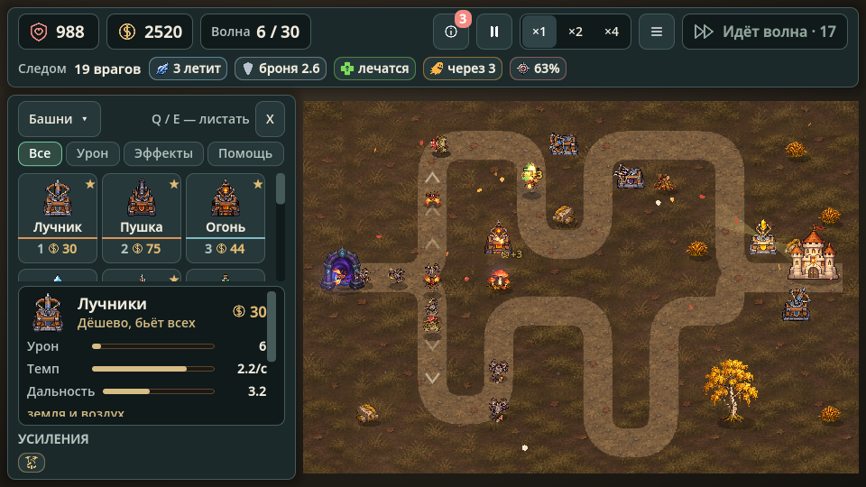
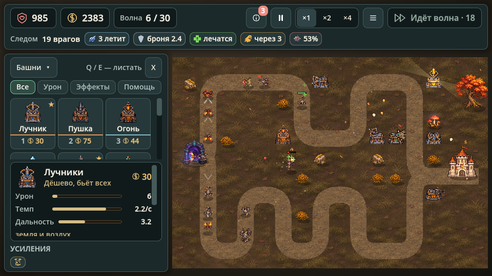

# PRO-213 · Генератор статических развилок

**База:** ветка PRO-147 (PR #16, `da5648b`) → PR #15 (PRO-139) → PR #14 → #13 → #11. Ни один из них не слит. **Голова:** `timberwolfmax/pro-213-out-henerator-staticheskikh-razvilok`.

**Статус:** генератор под dev-флагом, в обычные забеги не попадает. Включение в ротацию — отдельное решение после PRO-147 (Done), ревью, CI и плейтеста владельца.

**Продолжение:** PRO-141 проверил два пространственно разнесённых портала (боты, холдаут): оборона разделяется, но баланс не достигнут, см. [two-portal-experiment.md](two-portal-experiment.md).

**Короткий вывод:**
- генератор выдаёт корректные развилки: 100% проверенных карт, откат 0% и 0,3%;
- обычные забеги не изменились;
- развилка с одним порталом **заметно сложнее для ботов**. Это не ошибка, а цена деления обороны на две дороги: при одной дороге на тех же картах сложность прежняя (§6);
- **поздняя игра одним входом не решается**: лагерь у портала по-прежнему накрывает начало обеих дорог (§7). Нужен второй портал (PRO-141).

## 1. Что генерируется

Два семейства, только по явному запросу: `TDMap.generate(seed, "fork_even" | "fork_skew")`. В `TDMap.FAMILIES` их нет, `family_for` их не выдаёт.

| Семейство | Что это | Длины дорог (1 000 сидов) | Отношение длин | Откат |
|---|---|---|---|---|
| `fork_even` | две дороги почти равной длины | 30–40, медиана 31 / 31 | 1,00–1,15 (медиана 1,07) | **0 из 1 000** |
| `fork_skew` | длинная и короткая дорога | 30–42, медиана 31 / 36 | 1,20–1,50 (медиана 1,28) | **3 из 1 000** |

Устройство одинаковое:
- портал на левом краю (строка 3–6);
- **общий участок у входа — 1–3 клетки**, затем развилка. Распределение: `fork_even` — 1 / 2 / 3 клетки у 43% / 32% / 24% карт, `fork_skew` — 1 / 2 у 71% / 29%. Длинный общий ствол не закрепляется, как и решил владелец;
- северная и южная дороги — змейки в своих полосах поля, между полосами свободные строки входа и замка;
- **слияние** на столбце 10–12 и общий горизонтальный участок к замку длиной 4–6 клеток.

Враги идут по дорогам по очереди (`route_plan = [0, 1]`). Шаблон фиксирован, оборону рой не читает, идущий враг дорогу не меняет. Босс, дети деления, прислужники и выводок обрабатываются как в PRO-139: босс берёт дорогу по очереди, дети остаются на дороге родителя.

## 2. Проверки карты и откат

Каждая выданная развилка проходит `TDMap.route_problems`:
- один вход и один замок;
- последний участок горизонтальный ≥ 3 клеток;
- дороги не касаются;
- нет встречного движения, циклов и тупиков;
- у каждой дороги есть свои клетки;
- длина каждой дороги 30–90 клеток, отношение ≤ 1,5;
- вход не ближе 8 клеток к замку по прямой;
- не меньше 40 мест под башни (медиана 94 у `fork_even`, 88 у `fork_skew`).

Плюс проверки семейства: отношение длин в своём диапазоне, общий ствол 1–3, участок у замка ≥ 3. Мостов и пересечений нет (PRO-142).

**Откат.** Если за 400 попыток корректной развилки нет, выдаётся обычная карта сида (`fork_fallback = true`). Это видно в журнале плейтеста и в отчётах харнесса. Откаты бывают только у `fork_skew`: ему нужны обе дороги ≥ 30 клеток при отношении ≥ 1,2, а длинная полоса у некоторых сидов не помещается. Так вышло на 3 из 1 000 сидов.

**Почему порог длины 30, а не 36, как у обычных карт.** Поле 16×10. Две непересекающиеся дороги с местом под башни делят высоту пополам, и каждой змейке достаётся полоса в 3–5 строк. Без укорачивающего разброса длина маршрута 19–49 клеток, медиана 29. С порогом 36 большинство сидов уходило бы в откат.

Порог 30 — осознанное решение, и его последствия проверены контролем в §6. Те же карты с одной дорогой играются как обычные (win30 `mixed` на normal 0,8–1,0 против 0,95). Короткая дорога сама по себе не делает игру сложнее.

## 3. Волны, гены, перки и рекорды

- У генератора развилок свой генератор случайных чисел (`seed ^ 0x3c6ef372`). Вариант для `--map=forks` тоже выбирается своим (`seed ^ 0x6a09e667`). На развилке волны, гены и перки сида те же, что на обычной карте, — это проверяет тест.
- Обычные карты не изменились:
  - `balance_audit --late=1` на 14 ячейках — **14 из 14 файлов байт-в-байт**;
  - `tests/legacy_parity.gd` — **снимки 6 из 6** на финальном HEAD.
- Рекорд развилки хранится по своей геометрии (PRO-147): тот же сид на обычной карте — отдельный рекорд.

## 4. Интерфейс

Новых ассетов нет, интерфейс PRO-191 не перегружается:
- **дорога** — объединение полос обеих веток (PRO-139);
- **шевроны:** в начале каждой ветки бегут три полупрозрачные стрелки — видно, где дорога делится и куда идут враги;
- **подсказка «Две дороги»** в первых волнах: «Враги идут по двум дорогам по очереди: 50% — по северной, 50% — по южной. Башня у развилки достаёт обе». Без обещания адаптации;
- **тревога «Открыта южная (северная) дорога»**, если собственные клетки одной дороги обстреливаются меньше чем на 35%, а у другой покрытие выше хотя бы на 30 п.п.

| `fork_even`, сид 1003 | `fork_skew`, сид 1003 |
|---|---|
|  |  |

Скриншоты в большом разрешении: `img/pro213-fork_even-1003-1920x1080.png`, `img/pro213-fork_skew-1003-1920x1080.png`.

## 5. Боты и харнесс

Исправлено, чтобы не делать выводов по боту, который видит одну ветку:
- **размещение.** `balance_audit` (`_cells_for`, `_cover`) и `bot.gd` оценивают клетки по всем дорогам с весом доли врагов на каждой, а не только по `routes[0]`. На карте с одним путём расчёт прежний, числа те же;
- **метрики по дорогам** (только на развилке): `waves[].routes` — gate20, p90, max, доля дальше 40% и прорывы по каждой дороге (доля пути — своей дороги); `cov20_routes` — покрытие первых 20% каждой дороги. В отчёте партии — длины, общие участки, геометрия; `fork_fallback`, если был откат. Метрики PRO-192/212 на одиночных картах не изменились;
- **приоритет целей** при разных длинах — по расстоянию до замка (PRO-139, `fork_check`);
- **`--route-plan=0`** — только для диагностики: все враги по одной дороге.

## 6. Результаты ботов

`tests/fork_matrix.sh`: 4 стратегии × normal/hard × `fork_even`/`fork_skew` × 10 сидов, до 35-й волны. Сравнение — с одиночными картами тех же сидов и стратегий (база PRO-212, 4 семейства). Сводка — `data/pro213/bots_summary.md`, партии — `bots_games.csv`.

| Карты | партий | win30 normal | win30 hard | дожили до 21-й | прорывов на волну 1–29 | потеря жизней на 20-й | вложено к 20-й / 29-й |
|---|---|---|---|---|---|---|---|
| одиночные (4 семейства) | 320 | 0,89 | 0,43 | 0,72 | 0,12 | 0,83 | 2 350 / 4 504 |
| `fork_even` | 80 | **0,30** | **0,03** | 0,23 | 1,28 | 1,06 | 2 345 / 4 469 |
| `fork_skew` | 80 | **0,42** | **0,08** | 0,38 | 1,00 | 1,38 | 2 277 / 4 455 |

Развилка с одним порталом для ботов намного сложнее. Золото то же (вложено столько же), а проигрывают в основном **рано**: в волнах 1–10, пока башен мало. Например, `owner2` на Hard: 12 прорывов за волны 1–5 на развилке против 4 на одиночных картах.

**Это не ошибка покрытия или маршрутов.** Контроль — те же карты, все враги по одной дороге (`data/pro213/control_summary.md`):

| | одиночные | развилка: обе дороги | все по дороге 0 | все по дороге 1 |
|---|---|---|---|---|
| `mixed` normal, win30 (`fork_even` / `fork_skew`) | 0,95 | 0,30 / 0,40 | 1,00 / 0,80 | 1,00 / 0,90 |
| `mixed` hard | 0,53 | 0,00 / 0,20 | 0,50 / 0,30 | 0,50 / 0,50 |
| `owner2` normal | 0,82 | 0,20 / 0,20 | 0,80 / 0,60 | 0,60 / 0,40 |
| `owner2` hard | 0,30 | 0,00 / 0,00 | 0,20 / 0,00 | 0,20 / 0,20 |

С одной дорогой сложность возвращается к уровню одиночных карт. Значит, её даёт именно деление того же бюджета на две дороги. Покрытие начала обеих дорог у ботов полное (cov20 1,00 / 1,00), то есть бот видит обе ветки.

**Вывод:** развилка в нынешнем виде — заметное повышение сложности, особенно в начале. Его нельзя выпускать без отдельного решения о балансе. Варианты для владельца, вне этой задачи (здесь экономика и HP не меняются):
- больше стартового золота на картах с развилкой;
- меньшая доля врагов на второй дороге в первых волнах;
- более длинный общий участок у входа в начале.

Решение — после живого плейтеста: бот не умеет то, что делает человек, например строить у самой развилки.

## 7. Лагерь у входа и поздняя игра

`tests/fork_layouts.gd` — одинаковый набор из 10 башен первого уровня без улучшений, 15 волн, 20 сидов на семейство, жизней с запасом. Смотрим распределение, а не победу. Данные — `data/pro213/layouts.json`.

| Карта | Расстановка | прорывов на волну С / Ю | cov20 С / Ю | собственных клеток под огнём С / Ю |
|---|---|---|---|---|
| `fork_even` | лагерь у входа | 3,9 / 4,5 | **1,00 / 1,00** | 0,45 / 0,44 |
| `fork_even` | поровну по дорогам | 4,1 / 2,7 | 0,78 / 0,79 | 0,94 / 0,97 |
| `fork_even` | одна сторона (север) | 1,7 / **7,3** | 0,86 / 0,47 | 0,98 / 0,37 |
| `fork_even` | как бот | 3,7 / 3,8 | 0,92 / 0,89 | 0,94 / 0,90 |
| `fork_skew` | лагерь у входа | 4,3 / 4,3 | **1,00 / 1,00** | 0,46 / 0,43 |
| `fork_skew` | поровну по дорогам | 5,2 / 3,2 | 0,78 / 0,72 | 0,94 / 0,92 |
| `fork_skew` | одна сторона (север) | 1,6 / **8,2** | 0,92 / 0,23 | 0,99 / 0,18 |
| `fork_skew` | как бот | 3,7 / 3,1 | 0,73 / 0,64 | 0,87 / 0,83 |

- **Позиции у общего входа по-прежнему накрывают начало обеих дорог** (cov20 1,00). По прорывам лагерь у входа сопоставим с расстановкой поровну (8,4 против 6,7 на волну у `fork_even`, 8,6 против 8,4 у `fork_skew`). Короткий общий ствол не отменяет лагерь у портала.
- **Расстановка на одну сторону наказывается:** вторая дорога пропускает 7–8 врагов на волну. Тактический выбор есть: оборону нужно распределять.
- **Поздние волны** (боты, партии, дожившие до 21-й):
  - `fork_even` — gate20 21–29 0,70, как на одиночных картах; p90 0,35 против 0,31;
  - `fork_skew` — gate20 0,45, p90 0,59, но дожили только 38% партий, и это меньше «ожидание», чем отбор: доживают партии с сильной обороной.

  **Один вход позднюю игру не решает:** враги всё равно выходят из одной точки, и оборона там накрывает обе дороги. Для этого нужен второй, пространственно отдельный портал (PRO-141).

## 8. Ручной плейтест

```bash
godot\run_fork.bat even 1003
```

```bash
godot\run_fork.bat skew 1003
```

Без аргументов (`godot\run_fork.bat`) — вариант по сиду, каждый забег новый. `proto` и `uneven` открывают технические карты PRO-139. Сид фиксирует карту, волны и гены для всех новых забегов сессии.

Журнал волн и действий игрока (`--playtest`) лежит в `%APPDATA%\Godot\app_userdata\Outadapt\playtest\`:
- **в заголовке:** геометрия, длины дорог, общий ствол у входа и участок у замка, план, откат;
- **в конце волны:** по каждой дороге — убито, прорвалось, доля собственных клеток под огнём;
- **по ходу:** что построено, улучшено и продано.

**Вопросы к плейтесту** (сначала исполнитель, затем владелец):
1. Заметны ли две дороги и место развилки с первого взгляда?
2. Удаётся ли распределить башни? Где ставятся первые башни — у развилки или на ветках?
3. Сохраняется ли тактическая ценность, есть ли выбор, а не одно правильное место?
4. Нет ли невозможных или нечестных карт, особенно в первых 5 волнах (боты проигрывают рано)?
5. Насколько сложнее обычной карты на normal: приемлемо или нужен баланс (§6)?

## 9. Данные и команды

Из папки `godot`, `godot` — консольный Godot 4.7.2.

```bash
GODOT=godot bash tests/fork_matrix.sh 11 10 0
```

```bash
python tests/fork_report.py --md=../docs/architecture/data/pro213/bots_summary.md --csv=../docs/architecture/data/pro213/bots_games.csv
```

```bash
godot --headless --path . --script res://tests/fork_layouts.gd -- --seeds=20 --waves=15 --out=../docs/architecture/data/pro213/layouts.json
```

```bash
godot --headless --path . --script res://tests/fork_maps_report.gd -- --seeds=1000 --out=../docs/architecture/data/pro213/fork_maps.csv
```

| Файл | Что |
|---|---|
| `fork_maps.csv` | 2 000 карт (сиды (i+1)·4243): длины дорог, отношение, общие участки, свободные клетки, скалы, геометрия, откат |
| `bots_summary.md`, `bots_games.csv` | боты на развилках против одиночных карт |
| `control_summary.md` | контроль: все враги по одной дороге |
| `layouts.json` | расстановки при одинаковом бюджете |
| `commands_matrix.txt`, `commands_ctrl.txt` | все команды прогонов |

**Тесты в CI:**
- `fork_gen_check` (17 проверок): обычная ротация не меняется; 1 000 сидов каждого семейства; детерминизм; потоки волн; один портал и прямая полёта; партия с обеими дорогами; сохранение посреди волны; подсказки;
- `fork_check` (PRO-139);
- `records_check` (PRO-147);
- `map_check`, `save_check` и остальные.
