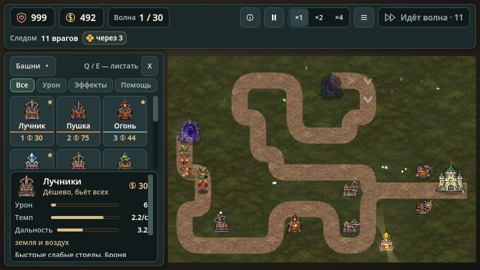
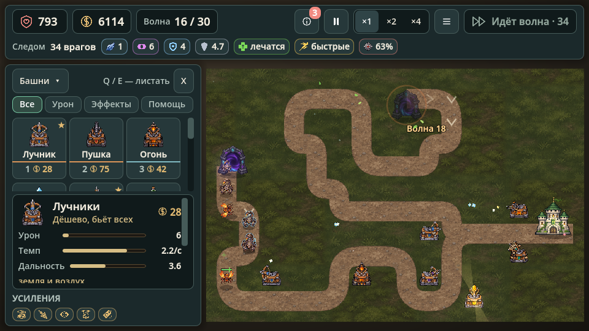
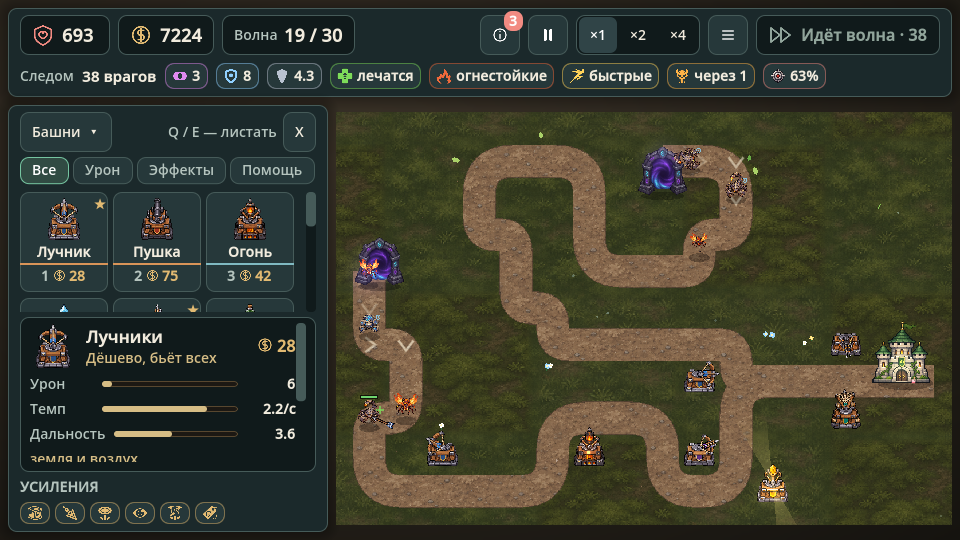

# PRO-141 · Два портала и динамическое открытие второго входа

**База:** ветка PRO-213 (PR #17, `ca1184e`) → PR #16 (PRO-147) → PR #15 (PRO-139) → #14 → #13 → #11. Ни один из них не слит. **Не наследует** ветку PRO-214 (PR #18): её расписание отвергнуто, из неё ничего не переносилось, кроме идеи метрик (отчёт написан заново). **Голова:** `timberwolfmax/pro-141-out-dva-portala-i-dinamicheskoe`.

**Статус:** изолированный технический прототип под dev-флагом; в обычные забеги не попадает. Ручной A/B владельца (§10) не сделан: я не могу играть в окно игры. Решение о расширении генератора и о публикации — отдельное, после плейтеста.

## Короткий вывод

- **Механизм сработал, баланс — нет.** Второй портал на другом краю поля действительно разбивает оборону: башен, достающих ворота обоих входов, у ботов 0,16–0,22 против 0,38–0,60 на развилке с одним порталом, доля урона обоих входов 0,28–0,40 против 0,72–0,96 (§2, §5). Лагерь у первого портала накрывает второй вход на 0,08–0,33 против 0,70–0,96 на развилке. Ранняя игра 1–10 и сохранения не меняются: до предупреждения партии с тем же сидом и покупками совпадают с контролем «один портал».
- **Гипотеза из задачи (предупреждение с 15-й, открытие с 18-й, 50/50) не прошла зарегистрированные пороги.** На независимом холдауте (20 сидов, 4 стратегии, normal/hard, две технические карты) win30 normal у контроля «один активный портал» 0,55 и 0,34, у гипотезы 0,21 и 0,12; на `portal_b` дожили до 21-й 0,23 против 0,47 (провал середины матча), жизней в волне открытия и следующей 3,0, утечки на втором входе 0,95 на волну. Ни одно из 7 плеч не выполнило все пороги; ближе всех открытие с 21-й волны (`p21`, `p21_a15`: не выполнены 2 критерия из 11 на каждой карте, §4).
- **Причина экономическая.** За 3–6 фаз строительства до открытия бот, у которого уже ~12 башен у первого входа, не может купить вторую оборону на тот же доход (~100–170 золота на волну): утечки на втором входе вместо этого оплачивает жизнями. Замороженный повтор покупок показывает цену: оборона, построенная без учёта второго входа, при открытии с 18-й теряет в волнах 18–24 6,0 и 7,5 жизни против 3,5 и 4,1 при контроле, а доживает до 21-й 0,11 и 0,16 против 0,38 и 0,49 (§6). Продажа четверти башен ради перестройки не помогает (§6). Ранняя расстановка под оба входа с первой волны (`p18_early`) ломает старт: до 18-й волны на `portal_b` доходят 0,24 партий против 0,68.
- **С Мастерской на максимуме второй портал проходим**, но тоже стоит заметную долю побед: win30 normal контроль 0,95 / 0,75, `p21_a15` 0,80 / 0,60 (`owner2`, `mixed`, §6). Это не доказательство честности для человека.
- **Не внедрялось:** новые башни, золото, HP, экономика, адаптивная доля (PRO-140), генератор порталов, ротация. Старые одно-портальные карты и развилки не менялись; сохранения и рекорды — как раньше.
- **Что дальше (решения владельца, §9):** оставить `portal_a`/`portal_b` как dev-карты для плейтеста; расширять не рекомендую, пока нет ответа на экономику второго фронта и на сложность самой геометрии (контроль на этих картах сам по себе заметно труднее обычных: 0,34–0,55 против 0,89).


## 1. Что реализовано

Две технические карты, `portal_a` и `portal_b` (`TDMap.PORTAL_MAPS`), запуск одним файлом:

```bash
godot\run_portal.bat
```

Без аргументов — `portal_a`, сид 1003, предупреждение с 15-й волны, открытие второго портала с 18-й, 50% врагов через него. Варианты: `run_portal.bat b 1003`, `... a 1003 control` (контроль: второй портал не открывается), `... early` (открытие с 16-й), `... late` (с 21-й). Флаги: `--map=portal_a|portal_b`, `--portal-open=N`, `--portal-announce=N`, `--portal-share=P`.

**Модель.** `TDMap.portal2` — на карте два входа: маршрут 0 — от портала 0 (левый край), маршрут 1 — от портала 1 (верхний край), у каждого свой участок до слияния, дальше общий участок до замка. Расписание: `portal_open` (с какой волны второй портал выпускает врагов), `portal_announce` (с какой волны интерфейс предупреждает), `portal_share` (% врагов через второй портал после открытия). Остальное — по умолчанию как раньше: без флага карты с двумя порталами не создаются.
- **Назначение маршрута** при выпуске врага, без поиска пути на каждом кадре и без RNG: до волны открытия все идут от портала 0; потом k-й враг волны идёт через второй портал, если `(k+1)·p/100 > k·p/100` (целочисленно). Число врагов, HP, награды и RNG волн, генов и перков не меняются, меняется только маршрут.
- **Малыши деления, прислужники босса, кладка выводка** остаются на дороге родителя; **летающие** летят по прямой от своего портала до замка (у каждого входа своя длина и направление); **босс** берёт маршрут по тому же правилу, что остальные; цель башен «ближайший к замку» сравнивается по оставшемуся пути на общей шкале (PRO-139).
- **Валидатор карты** (`route_problems`) для карт с двумя порталами проверяет другое, чем для обычных: входы разные, на левом, верхнем или нижнем краю и не в углу; расстояние между порталами ≥ 8 клеток; у каждой дороги первые 8 клеток свои (общего стартового узла нет); общий участок у замка ≥ 3 клеток; длины ≥ 30; вход не ближе 8 клеток к замку; места под башни; дороги не касаются, нет циклов и тупиков. Правила одно-портальных карт и развилок не менялись (`legacy` проверки в тесте).
- **Запасной вариант.** Если расписание неверно (открытие < 2, предупреждение позже открытия, доля вне 1–50%) или геометрия не проходит проверку, `TDMap.portal_test` детерминированно выдаёт карту с одним первым порталом (`portal_fallback = true`, видно в журнале); сохранение такой карты — обычное.
- **Сохранения:** поле `portal` (`open`, `announce`, `share`) пишется только на картах с двумя порталами; состояние «закрыт / объявлен / открыт» — функция волны, поэтому достаточно расписания. Проверено сохранение перед предупреждением, после него, в фазе строительства перед открытием, посреди волны открытия и до конца 19-й волны. Сохранения обычных карт и развилок байт-в-байт прежние.
- **Рекорды (PRO-147):** в канонической записи геометрии добавлена строка `portals:open…:announce…:share…`; другая волна открытия, другое предупреждение или другая доля — другой ключ; те же дороги без второго портала тоже другой; старые ключи без этой строки не менялись.

**Интерфейс** (PRO-191, без слов про рой и адаптацию):
- второй портал виден с начала забега: закрытый — тусклый, без анимации; с волны предупреждения вокруг него пульсирует кольцо и подпись «Волна N»; в волне открытия вспыхивает кольцо;
- карточка угрозы `TDThreats.portal_card` («Откроется второй портал» → «Со следующей волны — второй портал») с волной, долей и ответом «Защити северный подход: Лучники, Снайпер, Пушка» — в отчёте о волне и плашках «Следом»;
- совет в панели «Советы» «Второй портал» и тревога «Не защищён северный подход», когда подход обстреливается меньше чем на 35% (за одну волну до потока);
- дорога, о которой ещё не предупреждали, не считается «дырой в обороне» и не подсвечивается красным.





Большие кадры: `img/pro141-portal_a-1003-w16-1920x1080.png`, `img/pro141-portal_a-1003-w19-1920x1080.png`; вторая карта: `img/pro141-portal_b-1003-w16-960x540.png`. Кадры сняты демо-режимом (`--shot`), башни и враги в кадре — демо-расстановка.

## 2. Геометрия на поле 16×10: можно ли разнести входы

Карты найдены случайным поиском (`tests/portal_geometry.gd`): 40 000 попыток дали 128 корректных карт, 90 000 — 273 (≈ 0,3%), то есть на поле 16×10 разнесённые дороги длиной ≥ 30 клеток с местом под башни помещаются, но тесно. Из них отобраны две с минимальным перекрытием обстрела ворот (первые 20% пути каждого входа). Перекрытие — доля клеток под башни, достающих **оба** входа, среди клеток, достающих хотя бы один:

| Карта | расстояние между воротами | входы | перекрытие при дальности 2,6 / 3,2 / 3,5 / 5,2 / 7,2 / 8,3 |
|---|---|---|---|
| `portal_a` (дороги 31 и 34 клетки) | 8,1 | 8,5 | 0,00 / 0,00 / 0,00 / 0,09 / 0,33 / 0,47 |
| `portal_b` (31 и 30) | 6,6 | 8,5 | 0,00 / 0,00 / 0,02 / 0,17 / 0,41 / 0,47 |
| `fork_even` (40 карт PRO-213, один портал) | 0 | 0 | 0,50 / 0,60 / 0,61 / 0,84 / 0,89 / 0,90 |
| `fork_skew` (40 карт) | 0,1 | 0 | 0,46 / 0,56 / 0,61 / 0,80 / 0,85 / 0,91 |

(2,6–3,5 — Пушка, Огонь, Холод, Лучники и остальные башни; 5,2 — Снайпер, 7,2 — Снайпер с «Дальнобоем», 8,3 — с перками. Полные числа: `data/pro141/geometry_overlap.md`.)

**Вывод по геометрии.** Для всех башен, кроме Снайпера, входы действительно независимы: перекрытие 0 против 0,5–0,6 на развилке. Снайпер с «Дальнобоем» достаёт ворота обоих входов с трети всех клеток (0,33–0,41), с перками — почти с половины (0,47). Полной пространственной независимости на 16×10 не получить, но Снайпер — одна башня на ~100 золота, а не вся оборона; насколько этого достаточно, показывают расстановки ниже. Дороги найденных карт извилистые, одна-две «колбаски» у края поля (читается хуже, чем в генераторе обычных карт); генератор для порталов не писался (по заданию — после решения о расширении).

**Расстановки с одинаковым бюджетом** (`tests/portal_layouts.gd`: 10 башен первого уровня без улучшений, 20 сидов, золото не ограничивает, оба портала открыты с начала; `data/pro141/layouts.md`):

| Карта | Расстановка | cov20 ворот: 1-й / 2-й вход | башен, достающих оба входа | прорывов на волну: 1-й / 2-й |
|---|---|---|---|---|
| `portal_a` | лагерь у 1-го портала | 1,00 / **0,08** | 0,10 | 2,03 / 3,23 |
| `portal_a` | поровну (по очереди у ворот) | 1,00 / 1,00 | 0,00 | 5,89 / 3,41 |
| `portal_a` | «двойное назначение» (клетка, накрывающая больше всего точек обоих ворот) | 1,00 / 1,00 | 0,10 | 5,83 / 3,48 |
| `portal_a` | вся оборона вдоль 1-й дороги | 0,92 / 0,00 | 0,00 | 1,10 / 5,29 |
| `portal_b` | лагерь у 1-го портала | 1,00 / **0,33** | 0,10 | 1,43 / 2,11 |
| `portal_b` | поровну | 1,00 / 1,00 | 0,00 | 4,20 / 3,15 |
| `fork_even` (один портал) | лагерь у входа | 1,00 / **0,96** | 0,89 | 3,53 / 5,07 |
| `fork_even` | поровну | 1,00 / 1,00 | 0,94 | 4,30 / 4,03 |
| `fork_skew` | лагерь у входа | 1,00 / **0,70** | 0,79 | 3,38 / 6,13 |
| `fork_skew` | «двойное назначение» | 1,00 / 1,00 | 0,99 | 4,45 / 4,52 |

Лагерь у первого портала почти не накрывает второй (0,08–0,33 против 0,70–0,96 на развилке), а покрыть оба входа можно только отдельными башнями: башен, достающих оба входа, 0–0,10 против 0,89–0,99 на развилке. Оборона одной стороны пропускает 5 и больше врагов на волну на другой (выбор есть: нельзя оставить один вход без оборонительных башен). Пороги G1–G3 из регистрации выполнены.

## 3. План эксперимента и регистрация порогов

**Плечи** (`tests/portal_matrix.sh`), политика бота — когда он начинает строить под второй вход:

| Плечо | Что |
|---|---|
| `ctl` | контроль: та же геометрия, второй портал не открывается никогда (один активный портал) |
| `p18` | **гипотеза из задачи:** предупреждение с 15-й волны, открытие с 18-й, 50% врагов через второй портал; бот строит под второй вход после предупреждения |
| `p21_a15`, `p21`, `p18_s35` | варианты, отобранные по пилоту: открытие с 21-й, предупреждение с 15-й (шесть фаз строительства) / с 18-й (три); 35% врагов через второй портал |
| `p18_blind` | независимая реактивная политика: бот строит под второй вход только после открытия |
| `p18_early` | бот строит под оба входа с первой волны (расстановка «на два фронта», как на развилке) |
| `fork` | старый fork 50/50 с одним порталом: `fork_even`, `fork_skew` PRO-213, те же сиды |

Только пилот (сиды 0–9): `p16` (открытие с 16-й), `p14` (с 14-й), `p18_a12` (предупреждение с 12-й), `p18_s40` (доля 40%). В холдаут не вошли: в пилоте не лучше `p18`/`p21`.

**Хронология** (честно, в порядке событий):
1. **До пилота** — пороги v0 (`data/pro141/registration.json`, коммит `edece14`): абсолютные пороги win30 (normal ≥ 0,55 в среднем и ≥ 0,35 по каждой стратегии; hard ≥ 0,15) и геометрические G1–G3.
2. **Пилот** (сиды 0–9): 6 плеч, затем ещё 4 (раннее предупреждение, доля 35%, открытие с 14-й и с 21-й с ранним предупреждением) — ограниченно, без перебора. **Что показал:** у контроля на этих картах win30 normal 0,62 и 0,40, то есть абсолютный порог 0,55 из v0 недостижим даже для контроля на `portal_b`: сложность найденной геометрии не имеет отношения к вопросу про второй портал.
3. **Пороги v1** (коммит `577d7e8`, до холдаута): абсолютные пороги win30 заменены относительными к контролю на той же геометрии, добавлены три критерия (утечки на втором входе, доля урона у первого портала, провал середины матча). Геометрические пороги и набор метрик не менялись. После холдаута пороги не менялись.
4. **Холдаут** — сиды `(1000+i+1)·4243`, ранее не просматривались: 20 партий на ячейку (основная матрица), 10 — на чувствительности и повторе.

**Зарегистрированные пороги v1**, каждый — отдельно для каждой карты:

| Критерий | Порог |
|---|---|
| win30 normal ниже контроля | на 0,05–0,20 (второй портал чего-то стоит, но не ломает) |
| win30 normal каждой стратегии | ≥ 50% контроля у ≥ 3 из 4 стратегий |
| win30 hard | ≥ 50% контроля |
| дожили до 21-й | ≥ 75% контроля (нет провала на середине матча) |
| дожили до волны открытия | как контроль (разница не больше 0,03) |
| HP волн до предупреждения, размеры всех волн | те же, что у контроля (проверка равенства) |
| cov20 ворот второго входа к открытию | ≥ 0,5 в ≥ 70% партий |
| башен, достающих оба входа (волны 19–29) | ≤ 0,35 |
| доля урона ворот первого портала (19–29) | ≤ 0,75 |
| утечки на второй дороге (19–29) | ≤ 0,5 на волну |
| жизней в волне открытия и следующей | ≤ 3,0 |
| геометрия G1 | перекрытие обстрела ворот при дальности ≤ 3,5 ≤ 0,10 (0,00–0,02 — выполнено) |
| геометрия G2 | лагерь у первого портала: второй вход под обстрелом ≤ 0,40 ворот (0,08 и 0,33 — выполнено) |
| геометрия G3 | расстановка «поровну»: башен, достающих оба входа, ≤ 0,35 (0,00 — выполнено) |

**Правило приёмки:** расширение (генератор, плейтест, публикация) предлагается, только если хотя бы одно плечо выполняет **все** пороги на обеих картах и не проваливает чувствительности (адаптация ON, Мастерская). Иначе — отчёт и предложение изменить требования отдельной задачей.

Для `p18_early` проверка «HP до предупреждения те же, что у контроля» нарушена по построению (бот ведёт себя иначе с первой волны), это не ошибка.

## 4. Холдаут: основная матрица

Сиды 1000–1019, модель роя `off`, без Мастерской, по 160 партий на плечо в карте (4 стратегии × normal/hard × 20 сидов). Полные таблицы, CSV и вердикт: `data/pro141/holdout_summary.md`, `holdout_games.csv`.

| Карта | Плечо | win30 normal / hard | дожили до 18-й / 21-й / 30-й | жизней 1–10 / 11–20 / 21–29 | в волне открытия и следующей |
|---|---|---|---|---|---|
| `portal_a` | **ctl** | **0,55** / 0,03 | 0,58 / 0,35 / 0,35 | 8,1 / 5,7 / 0,0 | — |
| | **p18** | 0,21 / 0,00 | 0,58 / 0,29 / 0,21 | 8,1 / 6,7 / 3,0 | 0,8 |
| | p21_a15 | 0,31 / 0,00 | 0,58 / 0,30 / 0,24 | 8,1 / 6,4 / 2,6 | 0,3 |
| | p21 | 0,35 / 0,01 | 0,58 / 0,33 / 0,28 | 8,1 / 6,1 / 1,8 | 0,2 |
| | p18_s35 | 0,20 / 0,00 | 0,58 / 0,24 / 0,21 | 8,1 / 6,9 / 1,9 | 0,5 |
| | p18_blind | 0,15 / 0,00 | 0,58 / 0,23 / 0,15 | 8,1 / 7,4 / 2,9 | 1,2 |
| | p18_early | 0,31 / 0,04 | 0,41 / 0,25 / 0,24 | 10,0 / 5,2 / 1,2 | 0,0 |
| `portal_b` | **ctl** | **0,34** / 0,11 | 0,68 / 0,47 / 0,28 | 6,4 / 4,7 / 4,5 | — |
| | **p18** | 0,12 / 0,01 | 0,69 / 0,23 / 0,13 | 6,4 / 9,0 / 2,5 | 3,0 |
| | p21_a15 | 0,15 / 0,03 | 0,69 / 0,42 / 0,25 | 6,4 / 5,6 / 5,0 | 1,7 |
| | p21 | 0,17 / 0,00 | 0,68 / 0,46 / 0,21 | 6,4 / 5,2 / 6,8 | 2,3 |
| | p18_s35 | 0,15 / 0,01 | 0,69 / 0,33 / 0,19 | 6,4 / 7,6 / 3,2 | 1,8 |
| | p18_blind | 0,10 / 0,01 | 0,68 / 0,19 / 0,11 | 6,4 / 9,6 / 2,9 | 3,9 |
| | p18_early | 0,28 / 0,00 | 0,24 / 0,20 / 0,19 | 12,7 / 4,7 / 1,1 | 0,1 |
| `fork_even` | fork (один портал, 50/50) | 0,25 / 0,01 | 0,29 / 0,18 / 0,18 | 10,9 / 6,5 / 0,0 | — |
| `fork_skew` | fork (один портал, 50/50) | 0,29 / 0,00 | 0,34 / 0,19 / 0,19 | 10,0 / 7,3 / 0,0 | — |

**Вердикт по порогам** (число невыполненных критериев из 11; полный список — в конце `holdout_summary.md`):

| Плечо | `portal_a` | `portal_b` | Что провалено |
|---|---|---|---|
| p18 | 3 | 6 | win30 normal ниже контроля на 0,34 / 0,21 (больше 0,20); win30 по стратегиям; hard; на `portal_b` ещё провал середины матча (0,47 контроля), утечки на втором входе 0,95, жизни в волне открытия 3,04 |
| p18_blind | 4 | 6 | то же, ещё хуже |
| p18_early | 4 | 3 | провал середины матча, hard, стратегии; плюс нарушение равенства до предупреждения (по построению) |
| p18_s35 | 4 | 3 | стратегии, hard, провал середины матча |
| **p21** | **2** | **2** | win30 normal по стратегиям (2 и 1 из 4), hard; на `portal_a` ещё падение normal на 0,20 (граница) |
| **p21_a15** | **2** | **2** | hard; `portal_a` — падение normal на 0,24 (больше 0,20); `portal_b` — по стратегиям |

- Все выполняют: дожили до волны открытия как контроль (кроме `p18_early`), HP и размеры волн до предупреждения, cov20 второго входа к открытию, башен, достающих оба входа, доля урона у первого портала.
- **Hard** у контроля 0,03 и 0,11: на этих картах Hard почти не проходится и без второго портала, поэтому порог «≥ 50% контроля» на нём шумный; ни одно плечо его не выполнило.
- Парная разность win30 (портальное плечо минус контроль, normal + hard), `portal_a` / `portal_b`: p18 −0,18 / −0,16; p21 −0,11 / −0,14; p21_a15 −0,13 / −0,14; пар лучше / хуже, например `p18` на `portal_a`: 1 / 30.

## 5. Распределение обороны и ожидание у входа

Волны 19–29, холдаут (боты). Где не сказано иное, в ячейке `portal_a` / `portal_b` (у `fork` — `fork_even` / `fork_skew`):

| Метрика | `ctl` (один портал) | `p18` | `p21_a15` | `fork_even` / `fork_skew` |
|---|---|---|---|---|
| башен, достающих ворота **обоих** входов | 0,19 / 0,22 | 0,16 / 0,21 | 0,16 / 0,21 | **0,56 / 0,38** |
| доля урона башен, достающих оба ворота, среди башен, достающих хоть одни | 0,40 / 0,39 | 0,34 / 0,38 | 0,34 / 0,38 | **0,96 / 0,72** |
| доля урона ворот первого портала | 0,59 / 0,65 | 0,46 / 0,58 | 0,45 / 0,56 | 0,50 / 0,45 |
| cov20 ворот второго входа к открытию | 0,74 / 1,00 | 0,96 / 1,00 | 0,96 / 1,00 | 1,00 / 0,99 |
| gate20, волны 21–29 (1-й / 2-й вход; в ячейке `portal_a`; `portal_b`) | 0,58; 0,63 | 0,64 / 0,54; 0,66 / 0,64 | 0,59 / 0,54; 0,61 / 0,64 | 0,76 / 0,79; 0,45 / 0,46 |
| p90, 21–29 (1-й / 2-й вход; `portal_a`; `portal_b`) | 0,41; 0,27 | 0,43 / 0,66; 0,27 / 0,61 | 0,44 / 0,64; 0,27 / 0,68 | 0,26 / 0,23; 0,55 / 0,53 |
| утечки на вторую дорогу на волну (19–29) | 0,00 / 0,00 | 0,15 / 0,95 | 0,01 / 0,17 | 0,08 / 0,13 |

(У `ctl` дорога второго входа не используется врагами, поэтому её покрытие и утечки не важны.)

- **Концентрация ослабла.** На развилке бот почти весь урон сосредоточивает у общего ствола (0,72–0,96 урона у обоих ворот сразу); на двух порталах — 0,34–0,40. Башен, достающих оба входа, втрое меньше. Ворота второго входа к открытию прикрыты у ≥ 96% партий, доживших до 18-й: оборона реально разделилась.
- **Но второй вход слабее:** p90 пройденной доли пути на втором входе 0,61–0,68 против 0,27–0,44 у первого (враги заходят глубже), на `portal_b` при `p18` утечки на нём 0,95 на волну. Это цена второго фронта: даже при прикрытых воротах плотность обороны там ниже.
- **Время жизни** обычных наземных врагов в волнах 19–29 растёт при открытии второго входа (пилот: 7,2 → 8,8 с на `portal_a`, 4,1 → 6,5 с на `portal_b`).

## 6. Чувствительности

**Адаптация роя ВКЛ** (`--model=signature`, сиды 1000–1009, по 80 партий): win30 normal `portal_a` / `portal_b` — контроль 0,57 / 0,27; `p18` 0,20 / 0,15; `p21_a15` 0,25 / 0,15; `p18_s35` 0,23 / 0,15. Картина та же, что при OFF: портальное плечо ниже контроля на 0,07–0,21, провал середины матча на `portal_b` при `p18` (до 21-й 0,20 против 0,38). `data/pro141/holdout_on_summary.md`.

**Мастерская на максимуме** (`owner2`, `mixed`, сиды 1000–1009, по 40 партий): win30 normal / hard — `portal_a`: контроль 0,95 / 0,65, `p18` 0,85 / 0,45, `p21_a15` 0,80 / 0,45; `portal_b`: контроль 0,75 / 0,20, `p18` 0,35 / 0,00, `p21_a15` 0,60 / 0,10. Normal проходим и со вторым порталом, если оборона усилена Мастерской; `p18` на `portal_b` по-прежнему тяжёл (жизней в волне открытия и следующей 4,2). `data/pro141/holdout_ws_summary.md`.

**Замороженный повтор покупок** (`tests/portal_replay.sh`, 10 сидов, до 24-й волны; одни и те же покупки, перки и улучшения повторяются при разном расписании; в ячейках: жизней потеряно в волнах 18–24 / дожили до 21-й / утечки на втором входе на волну):

| Карта | оборона записана… | …повторена при контроле | …при открытии с 18-й | …при открытии с 21-й |
|---|---|---|---|---|
| `portal_a` | без второго входа (запись при контроле) | 3,5 / 0,38 / 0,00 | **6,0 / 0,11 / 0,35** | 3,8 / 0,38 / 0,02 |
| `portal_a` | с ответом на второй вход (запись при `p18`) | 4,4 / 0,34 / 0,00 | 5,4 / 0,29 / 0,18 | — |
| `portal_b` | без второго входа | 4,1 / 0,49 / 0,00 | **7,5 / 0,16 / 2,19** | 5,0 / 0,49 / 0,25 |
| `portal_b` | с ответом на второй вход | 2,7 / 0,45 / 0,00 | 6,4 / 0,29 / 0,81 | — |

Оборона, не готовившаяся ко второму входу, при открытии с 18-й коллапсирует (дожили до 21-й 0,11 и 0,16); оборона, построенная после предупреждения, теряет на 1,0–3,7 жизни больше, чем та же оборона без второго портала. Ответить можно, но он не бесплатный. `data/pro141/replay_summary.md`.

**Перестройка (исследование после холдаута, не зарегистрировано, сиды пилота 0–9).** Политика `rebuild`: в волну предупреждения бот продаёт четверть слабейших башен уровня ≤ 2 (возврат 70%) и строит заново с учётом второго входа. win30 normal `portal_a` / `portal_b`: `p18` 0,30 / 0,15 → `p18_rebuild` 0,25 / 0,12; `p21_a15` 0,53 / 0,25 → `p21_a15_rebuild` 0,28 / 0,23. Переносить оборону дороже, чем строить поверх: потеря 30% стоимости съедает выигрыш. `data/pro141/explore_rebuild_summary.md`.

## 7. Технические проверки

`tests/portal_check.gd` (в CI, 39 проверок):
- геометрия и валидатор: `portal_a` корректна; входы на левом и верхнем краях, разные, ≥ 8 клеток друг от друга, общего стартового узла нет; одинаковые входы, вход в углу, близкие входы и общий старт отклоняются; развилка PRO-139 и 60 обычных карт проверяются по-прежнему, два входа без `portal2` отклоняются;
- расписание: состояния «закрыт → объявлен → открыт» по волнам, маршруты точно по правилу `(k+1)·p/100`, доля 40%, пять неверных расписаний дают запасную карту с одним порталом;
- рекорды: другое открытие, предупреждение, доля или карта без второго портала — другой ключ; рекорд отдельный;
- партия без башен и с обороной у первого входа: волны 1–17 идентичны контролю (жизни, золото, RNG, маршруты, перки); выпущенные враги, включая босса 10-й волны, идут по расписанию; с 18-й оба входа в деле; летающие стартуют у своего портала, прямые полёта разные; малыши, прислужники босса и кладка выводка остаются на дороге родителя;
- сохранения: перед волнами 10, 15 (предупреждение), 17 и 18 (открытие), посреди 18-й волны; копия, загруженная перед 17-й, к концу 19-й в том же состоянии; битые расписания отвергаются, на картах без портала поля нет;
- интерфейс: до предупреждения нет ни карточки, ни совета, закрытая дорога не считается дырой; в волнах 15–17 карточка и совет, в 17-й тревога о необстреливаемом подходе; в фазе строительства 18-й — «со следующей волны»; после открытия — пояснение долей; слов про рой, адаптацию, эволюцию нет; оборона у обоих подходов — тревоги нет.

**Паритет обычных карт и развилок:** `balance_audit --late=1` на 14 ячейках (3 стратегии × 4 семейства на Hard + `signature` на двух семействах, по 3 сида, до 30-й волны) до (`ca1184e`) и после — **14 из 14 файлов байт-в-байт**; `tests/legacy_parity.gd` — **снимки 6 из 6**; ячейка развилки `owner2 normal fork_even`, 10 сидов, байт-в-байт равна матрице PRO-213 (единственное отличие — новый блок `portal` с метриками ворот в волнах); полный CI из 24 проверок (в том числе новая `portal_check`) прошёл на финальном коде.

## 8. Что не получилось и ограничения

- **Баланс не достигнут** (§4); гипотеза из задачи отвергнута ботами. Ни один вариант не выполнил все пороги.
- **Контроль на портальных картах сам труднее обычных:** win30 normal 0,34–0,55 против 0,89 на обычных. Дороги найденных карт 30–34 клетки (минимум обычных карт 36; на поле 16×10 с двумя порталами длиннее не помещается). Перед выпуском карты с двумя порталами нужен отдельный баланс самой геометрии (PRO-212 показывал, что длина дороги влияет на сложность).
- **Снайпер:** с «Дальнобоем» и перками достаёт ворота обоих входов с 33–47% клеток (§2). Полную независимость на 16×10 получить нельзя; предложение — отдельная задача про масштаб поля (больше поле и/или другая дальность Снайпера).
- **Ответ бота ограничен:** он покупает по весам клеток и не перестраивает оборону умело (политика `rebuild` — грубая попытка). Человек может иначе, это проверит живой gate (§10). Бот-статистика честность для человека не доказывает.
- **Только две карты**, найденные поиском, и 10-сидовые чувствительности; генератор порталов не писался.
- **Парные сравнения ограничены:** после предупреждения политика бота законно меняет ход партии, гены волн расходятся; идентичность проверена до предупреждения (тест и HP волн в отчёте).
- Пилот выбирал варианты `p21`, `p21_a15`, `p18_s35`; холдаут проверял их на новых сидах. Сравнение нескольких вариантов повышает шанс случайно пройти пороги — ни один и не прошёл.

## 9. Что дальше (решения владельца)

По ботам второй портал **не готов** к выпуску и к расширению генератора. Варианты, ничего из них не сделано:
- **Оставить как dev-карты** `portal_a`/`portal_b` и проверить живым игроком (§10), особенно `late` (открытие с 21-й, предупреждение с 15-й): ближайший вариант к порогам.
- **Если механизм нужен**, проверить в отдельных задачах то, что здесь запрещено: экономический запас на второй фронт при предупреждении (золото или скидка — то, от чего задача отказалась по умолчанию), меньшая доля или более короткая вторая дорога, нормализация сложности портальных карт (длина дорог), поле большего размера (и меньше перекрытие у Снайпера).
- **Не делать** адаптивную долю (PRO-140) и генератор порталов, пока живой плейтест не подтвердит, что угроза читается и ответ возможен.

## 10. Обязательный живой gate (за владельцем)

Бот-статистика честность для человека не доказывает. Ручной A/B на одном сиде, сначала Normal, затем Hard:

```bash
godot\run_portal.bat a 1003 control
```

```bash
godot\run_portal.bat a 1003
```

```bash
godot\run_portal.bat a 1003 late
```

```bash
godot\run_portal.bat b 1003 control
```

```bash
godot\run_portal.bat b 1003
```

`control` — контроль (второй портал не открывается), без аргумента — гипотеза (предупреждение с 15-й, открытие с 18-й), `late` — открытие с 21-й. Сид фиксирует карту, волны и гены. Журналы — `%APPDATA%\Godot\app_userdata\Outadapt\playtest\`; в заголовке расписание и клетки порталов, в конце волны — по каждой дороге убито, прорвалось, доля обстрела, `portal2_state` и `portal2_pct`.

Что записать в журнал на каждый забег: где поставлены первые башни; на какой волне и на какой дороге была первая потеря жизни; **когда заметил предупреждение** (кольцо на портале, карточка, совет) и что оно сказало; хватило ли золота и клеток **подготовиться до открытия**; пришлось ли продавать и переносить башни; **успел ли ответить** на втором входе; в какой волне забег закончился.

Вопросы: 1) читается ли второй портал и его срок с первого взгляда; 2) честно ли выглядит предупреждение, не обещает ли адаптацию; 3) можно ли подготовиться до открытия, на что уходят деньги; 4) приходится ли перераспределять оборону, есть ли выбор, а не одна правильная расстановка; 5) не появляется ли угроза у замка без времени.

## 11. Данные и команды

Из папки `godot`, `GODOT` — консольный Godot 4.7.2.

```bash
ARMS="ctl p18 p21_a15 p21 p18_s35 p18_blind p18_early fork" GODOT=godot bash tests/portal_matrix.sh holdout 11 20 1000
```

```bash
ARMS="ctl p18 p21_a15 p18_s35" MODELS="signature" GODOT=godot bash tests/portal_matrix.sh holdout_on 11 10 1000
```

```bash
ARMS="ctl p18 p21_a15" WS="1" STRATS="owner2 mixed" GODOT=godot bash tests/portal_matrix.sh holdout_ws 11 10 1000
```

```bash
GODOT=godot bash tests/portal_replay.sh 11 10 1000
```

```bash
godot --headless --path . --script res://tests/portal_layouts.gd -- --seeds=20 --seed-from=1000 --waves=14 --out=../docs/architecture/data/pro141/layouts.json
```

```bash
godot --headless --path . --script res://tests/portal_geometry.gd -- --eval
```

```bash
python tests/portal_report.py holdout --thresholds=../docs/architecture/data/pro141/registration.json --md=../docs/architecture/data/pro141/holdout_summary.md
```

| Файл (`data/pro141/`) | Что |
|---|---|
| `registration.json` | пороги: v1 до холдаута (v0 до пилота — в истории коммита `edece14`) |
| `pilot_summary.md`, `pilot_games.csv` | пилот, сиды 0–9, плечи портала и fork |
| `holdout_summary.md`, `holdout_games.csv` | холдаут 1000–1019, вердикт по порогам |
| `holdout_on_summary.md`, `holdout_ws_summary.md`, `replay_summary.md`, `explore_rebuild_summary.md` | чувствительности, повтор, перестройка |
| `layouts.md`, `layouts.json`, `geometry_overlap.md` | расстановки и перекрытие |
| `commands_*.txt` | команды прогонов |

